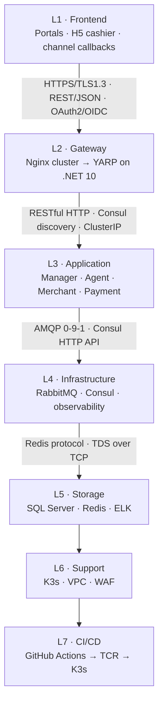

# Zenith Pay Platform

**Enterprise-grade payment platform architecture based on .NET 10 + DDD + Microservices + Cloud Native**

[Live overview](https://jackbeyant787878.github.io/Zentin.Payment/) ·
[Interactive architecture diagram](https://jackbeyant787878.github.io/Zentin.Payment/architecture.html) ·
[中文文档](README.zh-CN.md)

> **Status: in active development.**

---

## Product introduction

Zenith Pay is an aggregated payment platform for a three-tier **ISV / agent / merchant** hierarchy.
It covers the full payment link: merchant onboarding and rate configuration, multi-channel
transactions, refunds, split settlement, fund transfer, asynchronous merchant notification and
transaction reconciliation.

The platform references the complete business scenarios and design concepts of the open-source
**AgPayPlus** project, then models them from scratch. It is **not a code migration, version upgrade
or reconstruction of the old system** — it abandons the traditional three-tier architecture,
business coupling, simplistic data-driven modeling and fragmented design of legacy payment systems.

**Two entry points:**

| Page | Content |
| --- | --- |
| [Overview](https://jackbeyant787878.github.io/Zentin.Payment/) | Product capabilities, four business services, design principles, shared foundation |
| [Architecture](https://jackbeyant787878.github.io/Zentin.Payment/architecture.html) | Full seven-layer topology, component inventory, end-to-end payment request flow |

Both pages are available in English and Chinese.

---

## 1. System architecture overview

**Full interactive architecture diagram (with service flow and component description):**
[View complete architecture diagram](https://jackbeyant787878.github.io/Zentin.Payment/architecture.html)


### Seven-layer topology



---

## 2. Project background

Driven by real financial payment business scenarios, the platform is built entirely on the
**.NET 10 technology stack**, implementing standardized DDD domain modeling, microservice boundary
division, event-driven architecture and full cloud-native construction. The goal is a standardized,
commercial-grade, highly scalable and technical-debt-free modern enterprise payment middle platform.

---

## 3. Core project objectives

### 3.1 Business objective — domain modeling based on real payment scenarios

Payment systems have complex business rules, long order lifecycles, frequent state transitions,
multi-channel access, rigorous fund workflows and strong asynchronous dependencies. Traditional
database-table-driven development cannot meet the iteration requirements and fund-consistency
constraints of this business.

The project strictly follows **Domain-Driven Design**, focusing on business domains rather than
database structures, and models through entities, value objects, aggregate roots, domain services
and domain events.

- **Payment.Domain (core payment domain)** — payment orders, transaction records, payment channels,
  payment aggregate roots, order state machines and core payment domain events.
- Strict separation of **Entity, Value Object, Aggregate Root, Domain Service and Domain Event**
  for cohesive business logic, clear domain boundaries and controllable state transitions.

### 3.2 Architecture objective — cloud-native microservice system

The project abandons the monolithic architecture in favour of a **cloud-native microservice
architecture**, achieving service decoupling, unified governance and event-driven workflow.

**Overall topology**

```
Client request
  → YARP API Gateway (signature verification, permission authentication, traffic governance)
  → Business microservice cluster
  → RabbitMQ event bus (asynchronous business processing)
```

Core business microservices: **Merchant Service, Agent Profit-sharing Service, Platform Management
Service, Payment Core Service**. All business services are completely unaware of authentication
logic — traffic control and security verification are implemented at the gateway layer.

---

## 4. Enterprise-grade technical infrastructure

The project adopts a **production-grade gateway-centric security architecture**. Unlike traditional
per-service auth chains, the Identity Service Center acts only as a static token issuer. All request
authentication, signature verification and permission validation happen statelessly at the YARP
gateway. Business services eliminate authentication logic entirely.

### 4.1 Identity Service Center

- **Tech stack:** OpenIddict
- **Positioning:** independent identity token issuance center — **only responsible for JWT signing
  and issuance**, never involved in request-link verification.
- **Capabilities:** OAuth2, OpenID Connect, JWT private-key signature issuance, client management,
  role permission configuration, unified identity key management.

### 4.2 API Gateway (YARP)

- **Tech stack:** YARP high-performance .NET reverse proxy
- **Positioning:** unified traffic entrance — **owns full-link security verification and traffic
  governance**.
- **Capabilities:** request routing, dynamic service forwarding, **JWT public-key local signature
  verification, stateless authentication, interface signature verification, decoupled key
  compatibility**, rate limiting, service aggregation, full-link request interception.

### 4.3 Consul service discovery and configuration center

- **Capabilities:** automatic microservice registration, dynamic discovery, health checks,
  distributed KV unified configuration.
- **Value:** dynamic scaling, automatic fault elimination and global unified configuration.

### 4.4 SchedulerJob distributed task service

- **Tech stack:** Quartz.NET
- **Positioning:** unified background scheduling center for all asynchronous and scheduled payment
  tasks.
- **Scenarios:** closing overdue unpaid orders, asynchronous payment status sync, automatic
  reconciliation and settlement, exception retry and compensation, periodic fund clearing.

### 4.5 Self-developed general NuGet components

Published on NuGet.org, providing consistent underlying capabilities to every service:

| Package | Responsibility |
| --- | --- |
| `Zenith.Extensions.Consul` | Service registration, discovery and configuration center |
| `Zenith.Extensions.Rabbitmq` | Event bus, publish/subscribe, dead-letter queue, message idempotency |
| `Zenith.Extensions.Redis` | Distributed cache, distributed lock, rate limiter, hot-data cache |
| `Zenith.Extensions.Elasticsearch` | Structured log collection, retrieval and full-link tracing |

---

## 5. Business domain boundary planning

The legacy AgPayPlus backend contains four core business APIs: `agpay-manager-api`,
`agpay-agent-api`, `agpay-merchant-api`, `agpay-payment-api`. This project inherits those mature
business boundaries and **rebuilds each from scratch to .NET 10 DDD specifications**.

| Service | Domain | Responsibility |
| --- | --- | --- |
| **ManagerService** | Platform management | Platform configuration, channel management, payment parameters, global order management, risk-control settings |
| **AgentService** | Agent profit-sharing | Agent hierarchy, profit-sharing rules, revenue statistics, automatic split settlement, agent fund accounting |
| **MerchantService** | Merchant | Merchant settlement, profiles, application access, rate configuration, permissions, data statistics |
| **PaymentService** | Core payment | Order creation, cashier interaction, channel callback processing, order state machine, refunds, transaction records, notification callbacks |

---

## 6. Core architecture design concepts

### 6.1 DDD layered clean architecture

Every microservice follows the same four-layer clean architecture. Business services carry no
authentication or security logic, and the domain layer has zero external dependencies.

| Layer | Responsibility |
| --- | --- |
| **Domain** | Core business models, rules, domain events and specifications — pure business logic, no technical dependencies |
| **Application** | CQRS command/query scheduling, business process orchestration, domain event consumption |
| **Infrastructure** | Persistence, cache, message queue, third-party channel integration, task scheduling |
| **Presentation** | Minimalist API controllers — request receiving and response returning only |

### 6.2 Event-driven microservice architecture

A cross-service event bus on RabbitMQ achieves decoupling through domain events, with no hard-coded
service dependencies.

**Typical scenario — payment success workflow**

```
PaymentService publishes PaymentSucceededEvent
  → RabbitMQ event bus distribution
  → Downstream services consume asynchronously and complete their business iteration
```

---

## 7. Cloud-native and DevOps

- **Containerized deployment** — every service supports independent Docker packaging and stateless
  deployment: service isolation, version controllability, consistent environments.
- **Fully automated CI/CD (GitHub Actions)** — code push → build → unit test → Docker image →
  cluster deployment.
- **Kubernetes-evolvable** — currently deployed on lightweight K3s, fully compatible with standard
  Kubernetes; can evolve to autoscaling, rolling upgrades, gray release, cluster monitoring and
  configuration hot update.

---

## 8. Project core value

- **Technical** — a .NET 10 enterprise architecture benchmark implementing DDD, Clean Architecture,
  CQRS, event-driven architecture, microservices, cloud native and DevOps to production standards,
  without simplified demo logic.
- **Business** — a scalable, commercial-grade payment platform base supporting multi-merchant,
  multi-channel, multi-level profit-sharing and automatic reconciliation, extensible to SaaS
  multi-tenancy.
- **Learning** — a complete enterprise architecture practice built from scratch, accumulating
  advanced .NET 10 development, DDD modeling, microservice governance, distributed high-concurrency
  processing, cloud-native delivery and event-driven design.

---

## 9. Complete DDD engineering architecture

### 9.1 Solution structure

```
Zenith.Payment.Platform.sln
├── ManagerService      # aligns with agpay-manager-api  (platform management domain)
├── AgentService        # aligns with agpay-agent-api    (agent profit-sharing domain)
├── MerchantService     # aligns with agpay-merchant-api (merchant domain)
└── PaymentService      # aligns with agpay-payment-api  (core payment domain)
```

### 9.2 Standard four-layer structure of a single service

Taking the core **PaymentService** as an example:

```
PaymentService/
├── PaymentService.Presentation          # Presentation layer
│   └── Controllers                      # Minimalist API controllers
│
├── PaymentService.Application           # Application layer (orchestration & CQRS)
│   ├── Commands                         # Order creation, payment, refund, status change, fund operation
│   ├── Queries                          # Order query, transaction statistics, reconciliation, fund flow
│   ├── EventHandlers                    # Domain event consumers driving cross-domain workflow
│   ├── Dtos                             # Input/output DTO and model mapping
│   └── ApplicationServices              # Business assembly and transaction orchestration
│
├── PaymentService.Domain                # Domain layer (pure business, zero dependencies)
│   ├── Aggregates                       # PaymentOrder · PaymentTransaction · RefundRecord
│   ├── Entities                         # Domain sub-entities
│   ├── ValueObjects                     # Amount · Channel · Status · Rate
│   ├── DomainEvents                     # PaymentSucceeded · PaymentFailed · RefundCompleted · OrderTimeout
│   ├── Specifications                   # Domain business rule validation
│   └── DomainServices                   # Pure domain logic and core algorithms
│
├── PaymentService.Infrastructure        # Infrastructure layer (technical implementation)
│   ├── Data                             # EF Core, DbContext, unit of work, repository
│   ├── Caching                          # Redis cache, distributed lock, hot-data optimization
│   ├── MessageBus                       # RabbitMQ reliable event delivery
│   ├── ExternalChannel                  # Third-party channel integration (WeChat / Alipay)
│   ├── Configuration                    # Consul configuration and service registration
│   ├── Logging                          # Structured logging and ELK collection
│   └── JobIntegration                   # Quartz docking for timeout and compensation
│
├── PaymentService.Shared                # Shared layer
│   ├── Constants · Enums · Exceptions · Mappers
│
├── PaymentService.Tests                 # Domain rule and state machine verification
├── Dockerfile                           # Independent container deployment
└── appsettings.json                     # Service configuration (Consul hot update)
```

### 9.3 Core design advantages

- **Pure domain-driven modeling** — business-centric rather than data-driven; fund consistency and
  domain boundaries enforced through aggregate roots.
- **Strict CQRS read/write separation** — separates high-concurrency transaction writes from
  high-frequency order queries.
- **Event-driven decoupling** — core business actions trigger domain events that drive downstream
  services.
- **Pure business domain layer** — fund rules, state machines and business logic fully decoupled
  from middleware and databases, giving high cohesion and testability.
- **Single-responsibility layering** — Presentation forwards, Application orchestrates, Domain
  decides, Infrastructure implements.

---

## 10. Positioning

**Zenith Pay Platform is a completely redesigned and implemented enterprise payment architecture
practice based on .NET 10, DDD, microservices and cloud-native technology, referencing the business
model of AgPayPlus aggregated payment.** It adopts a production-grade gateway security architecture
with YARP as the unified traffic and security entrance and OpenIddict for exclusive token issuance,
combined with Consul service governance, Quartz.NET scheduling and the self-developed
`Zenith.Extensions` components as its standardized technical foundation.