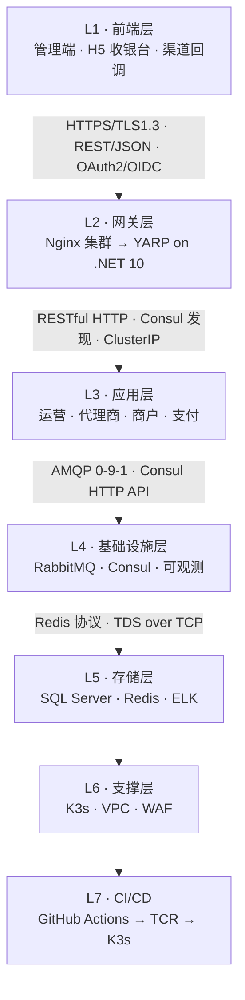

# Zenith Pay Platform

**基于 .NET 10 + DDD + 微服务 + 云原生的企业级支付平台架构**

[在线总览](https://jackbeyant787878.github.io/Zentin.Payment/zh/) ·
[交互式架构图](https://jackbeyant787878.github.io/Zentin.Payment/zh/architecture.html) ·
[English](README.md)

> **状态：持续研发中。**

---

## 产品介绍

Zenith Pay 是面向 **ISV / 代理商 / 商户**三级体系的聚合支付平台，覆盖支付全链路：
商户进件与费率配置、多渠道交易、退款、分账结算、资金转账、异步商户通知与交易对账。

本项目参考开源项目 **AgPayPlus** 的完整业务场景与设计理念，再从零重新建模。
它**不是代码迁移、版本升级或对旧系统的重构** —— 它抛弃了传统三层架构、业务耦合、
简单的数据驱动建模，以及遗留支付系统碎片化的架构设计。

**两个入口：**

| 页面 | 内容 |
| --- | --- |
| [产品总览](https://jackbeyant787878.github.io/Zentin.Payment/zh/) | 产品能力、四个业务服务、设计思想、共享底座 |
| [系统架构](https://jackbeyant787878.github.io/Zentin.Payment/zh/architecture.html) | 完整七层拓扑、组件清单、端到端支付请求流程 |

两个页面都提供中英文版本。

---

## 1. 系统架构总览

**完整交互式架构图（含服务流程与组件说明）：**
[查看完整架构图](https://jackbeyant787878.github.io/Zentin.Payment/zh/architecture.html)


### 七层拓扑



---

## 2. 项目背景

以真实金融支付业务场景为驱动，平台完全基于 **.NET 10 技术栈**构建，落地标准化 DDD 领域建模、
微服务边界划分、事件驱动架构与完整的云原生建设。目标是交付一个标准化、商业级、高可扩展、
无技术债的现代企业支付中台。

---

## 3. 核心项目目标

### 3.1 业务目标 —— 基于真实支付场景的领域建模

支付系统业务规则复杂、订单生命周期长、状态流转频繁、多渠道接入、资金流程严谨、异步依赖强。
传统数据库表驱动的开发方式，无法满足复杂支付业务的迭代要求与资金一致性约束。

本项目严格遵循**领域驱动设计（DDD）**，聚焦业务域而非数据库结构，通过实体、值对象、聚合根、
领域服务与领域事件完成专业业务建模。

- **Payment.Domain（支付核心域）** —— 支付订单、交易流水、支付渠道、支付聚合根、订单状态机
  与核心支付领域事件。
- 严格区分**实体、值对象、聚合根、领域服务、领域事件**，实现业务逻辑内聚、领域边界清晰、
  状态流转可控。

### 3.2 架构目标 —— 云原生微服务体系

项目抛弃单体架构，采用**云原生微服务架构**，实现服务解耦、统一治理与事件驱动流程。

**整体拓扑**

```
客户端请求
  → YARP API 网关（签名校验、权限认证、流量治理）
  → 业务微服务集群
  → RabbitMQ 事件总线（异步业务处理）
```

核心业务微服务：**商户服务、代理商分润服务、平台管理服务、支付核心服务**。
所有业务服务完全不感知认证逻辑 —— 流量治理与安全校验全部在网关层实现。

---

## 4. 企业级技术基础设施

项目采用**生产级网关中心化安全架构**。与低效的传统逐服务鉴权链路不同，身份服务中心只作为
静态令牌签发方。所有请求认证、签名校验与权限验证都在 YARP 网关无状态完成，业务服务彻底
消除认证逻辑。

### 4.1 身份服务中心

- **技术栈：** OpenIddict
- **核心定位：** 独立的身份令牌签发中心，**只负责 JWT 签名与签发**，不参与任何请求链路校验。
- **能力：** OAuth2、OpenID Connect、JWT 私钥签名签发、客户端管理、角色权限配置、统一身份密钥管理。

### 4.2 API 网关（YARP）

- **技术栈：** YARP 高性能 .NET 反向代理
- **核心定位：** 统一流量入口，**承担全链路安全校验与流量治理**。
- **能力：** 请求路由、动态服务转发、**JWT 公钥本地验签、无状态认证、接口签名校验、
  密钥解耦兼容**、限流、服务聚合、全链路请求拦截。

### 4.3 Consul 服务发现与配置中心

- **能力：** 微服务自动注册、动态发现、健康检查、分布式 KV 统一配置管理。
- **价值：** 支撑动态扩缩容、故障自动剔除与全局统一配置。

### 4.4 SchedulerJob 分布式任务服务

- **技术栈：** Quartz.NET
- **核心定位：** 统一后台调度中心，承载支付域所有异步与定时任务。
- **业务场景：** 超时未支付关单、异步支付状态同步、自动对账结算、业务异常重试补偿、周期资金清算。

### 4.5 自研通用 NuGet 组件

已发布到 NuGet.org，为所有服务提供一致开箱即用的底层能力：

| 包名 | 职责 |
| --- | --- |
| `Zenith.Extensions.Consul` | 服务注册、发现与配置中心 |
| `Zenith.Extensions.Rabbitmq` | 事件总线、发布订阅、死信队列、消息幂等 |
| `Zenith.Extensions.Redis` | 分布式缓存、分布式锁、限流器、热点数据缓存 |
| `Zenith.Extensions.Elasticsearch` | 结构化日志采集、检索与全链路追踪 |

---

## 5. 业务领域边界规划

旧版 AgPayPlus 后端包含四个核心业务 API：`agpay-manager-api`、`agpay-agent-api`、
`agpay-merchant-api`、`agpay-payment-api`。本项目完整继承这些成熟的业务边界，
再**按 .NET 10 DDD 规范从零重建**。

| 服务 | 领域 | 职责 |
| --- | --- | --- |
| **ManagerService** | 平台管理域 | 平台配置、渠道管理、支付参数、全局订单管理、风控参数 |
| **AgentService** | 代理商分润域 | 代理商层级、分润规则、收益统计、自动分账、代理商资金账务 |
| **MerchantService** | 商户域 | 商户进件、档案、应用接入、费率配置、权限、经营统计 |
| **PaymentService** | 支付核心域 | 下单、收银台交互、渠道回调处理、订单状态机、退款、交易流水、通知回调 |

---

## 6. 核心架构设计思想

### 6.1 DDD 分层整洁架构

所有微服务遵循同一套四层整洁架构。业务服务不承载认证与安全逻辑，领域层零外部依赖。

| 层 | 职责 |
| --- | --- |
| **Domain 领域层** | 核心业务模型、规则、领域事件与规约 —— 纯业务逻辑，无技术依赖 |
| **Application 应用层** | CQRS 命令查询调度、业务流程编排、领域事件消费 |
| **Infrastructure 基础设施层** | 持久化、缓存、消息队列、第三方渠道对接、任务调度 |
| **Presentation 表示层** | 极简 API 控制器 —— 只负责接收请求与返回响应 |

### 6.2 事件驱动微服务架构

基于 RabbitMQ 的跨服务事件总线，通过领域事件实现解耦，服务之间没有硬编码依赖。

**典型场景 —— 支付成功流程**

```
PaymentService 发布 PaymentSucceededEvent
  → RabbitMQ 事件总线分发
  → 下游服务异步消费，完成各自业务迭代
```

---

## 7. 云原生与 DevOps

- **容器化部署** —— 每个服务支持独立 Docker 打包与无状态部署：服务隔离、版本可控、环境一致。
- **全自动 CI/CD（GitHub Actions）** —— 代码推送 → 构建 → 单元测试 → Docker 镜像 → 集群部署。
- **可演进到 Kubernetes** —— 当前稳定运行在轻量 K3s，完全兼容标准 Kubernetes，
  可无缝演进到自动扩缩容、滚动升级、灰度发布、集群监控与配置热更新。

---

## 8. 项目核心价值

- **技术价值** —— .NET 10 企业级全架构标杆项目，按生产标准落地 DDD、整洁架构、CQRS、
  事件驱动、微服务、云原生与 DevOps，不做简化的演示逻辑。
- **业务价值** —— 可扩展的商业级支付平台底座，支持多商户、多渠道、多级分润与自动对账结算，
  可扩展到 SaaS 多租户。
- **学习价值** —— 从零构建的完整企业级架构实践，沉淀 .NET 10 高级开发、DDD 建模、
  微服务治理、分布式高并发处理、云原生交付与事件驱动设计等核心能力。

---

## 9. 支付业务完整 DDD 工程架构

### 9.1 解决方案结构

```
Zenith.Payment.Platform.sln
├── ManagerService      # 对应 agpay-manager-api  （平台管理域）
├── AgentService        # 对应 agpay-agent-api    （代理商分润域）
├── MerchantService     # 对应 agpay-merchant-api （商户域）
└── PaymentService      # 对应 agpay-payment-api  （支付核心域）
```

### 9.2 单服务标准四层结构

以核心 **PaymentService** 为例：

```
PaymentService/
├── PaymentService.Presentation          # 表示层
│   └── Controllers                      # 极简 API 控制器
│
├── PaymentService.Application           # 应用层（编排与 CQRS）
│   ├── Commands                         # 下单、支付、退款、状态变更、资金操作
│   ├── Queries                          # 订单查询、交易统计、对账数据、资金流水
│   ├── EventHandlers                    # 领域事件消费者，驱动跨域流程
│   ├── Dtos                             # 输入输出 DTO 与模型映射
│   └── ApplicationServices              # 业务组装与事务编排
│
├── PaymentService.Domain                # 领域层（纯业务，零依赖）
│   ├── Aggregates                       # PaymentOrder · PaymentTransaction · RefundRecord
│   ├── Entities                         # 领域子实体
│   ├── ValueObjects                     # Amount · Channel · Status · Rate
│   ├── DomainEvents                     # PaymentSucceeded · PaymentFailed · RefundCompleted · OrderTimeout
│   ├── Specifications                   # 领域业务规则校验
│   └── DomainServices                   # 纯领域逻辑与核心算法
│
├── PaymentService.Infrastructure        # 基础设施层（技术实现）
│   ├── Data                             # EF Core、DbContext、工作单元、仓储
│   ├── Caching                          # Redis 缓存、分布式锁、热点数据优化
│   ├── MessageBus                       # RabbitMQ 事件可靠投递
│   ├── ExternalChannel                  # 第三方渠道对接（微信 / 支付宝）
│   ├── Configuration                    # Consul 配置读取与服务注册
│   ├── Logging                          # 结构化日志与 ELK 采集
│   └── JobIntegration                   # Quartz 对接，超时与补偿
│
├── PaymentService.Shared                # 共享层
│   ├── Constants · Enums · Exceptions · Mappers
│
├── PaymentService.Tests                 # 领域规则与状态机验证
├── Dockerfile                           # 独立容器部署
└── appsettings.json                     # 服务配置（支持 Consul 热更新）
```

### 9.3 核心设计优势

- **纯领域驱动建模** —— 以业务为中心而非数据驱动，通过聚合根保证资金一致性与领域边界。
- **严格 CQRS 读写分离** —— 分离高并发交易写入与高频订单查询。
- **事件驱动解耦** —— 核心业务动作触发领域事件，驱动下游服务。
- **纯业务领域层** —— 资金规则、状态机与业务逻辑与中间件、数据库完全解耦，高内聚且可测试。
- **单一职责分层** —— 表示层转发、应用层编排、领域层决策、基础设施层实现。

---

## 10. 项目定位

**Zenith Pay Platform 是基于 .NET 10、DDD、微服务与云原生技术体系，参考 AgPayPlus 聚合支付
业务模型，完全重新设计并实现的企业级支付架构实践。** 项目采用生产级网关安全架构，以 YARP
作为统一流量与安全入口、OpenIddict 专职令牌签发，结合 Consul 服务治理、Quartz.NET 任务调度
与自研 `Zenith.Extensions` 通用组件作为标准化技术底座。